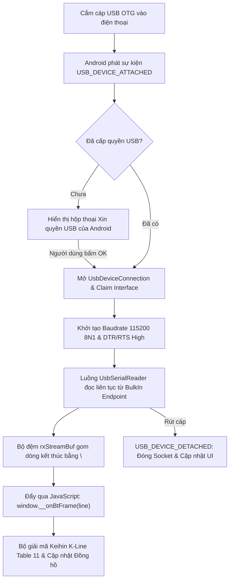

# Kế hoạch Triển khai: USB-to-TTL OTG & Hoàn thiện Giao diện TFT Cockpit

> [!IMPORTANT]
> **Phạm vi thực hiện:** Tập trung 100% vào ứng dụng **Android APK** (không can thiệp PC dashboard). Hệ thống hỗ trợ cắm trực tiếp module USB-to-TTL (CH340, CP2102, FT232, PL2303, CDC-ACM) qua cổng Type-C / Micro-USB OTG của điện thoại, không cần root máy, nhận diện tự động và chạy song song với Bluetooth SPP/BLE.

---

## 1. Kiến trúc Trình điều khiển USB-to-TTL OTG (Native Android Java)

### 1.1. Các dòng Chip USB-Serial được hỗ trợ
Module USB-to-TTL trên thị trường DIY Việt Nam sử dụng các chip thông dụng sau. Hệ thống sẽ tích hợp driver native bằng Android USB Host API (`android.hardware.usb.*`), không phụ thuộc thư viện bên ngoài:

| Dòng Chip | Vendor ID (VID) | Product ID (PID) | Ghi chú & Lệnh khởi tạo Baudrate (115200 8N1) |
| :--- | :--- | :--- | :--- |
| **CH340 / CH341** | `0x1A86` | `0x7523`, `0x5523`, `0x0440` | Phổ biến nhất (module vàng/xanh 15k). Cấu hình qua vendor control transfer `0x9A` & `0xA4`. |
| **CP2102 / CP2104** | `0x10C4` | `0xEA60`, `0xEA70` | Module Silicon Labs. Cấu hình qua `IFC_ENABLE (0x00)` và `SET_LINE_CTL (0x03)`. |
| **FTDI FT232R** | `0x0403` | `0x6001`, `0x6014` | Chip chuẩn công nghiệp FTDI. Khởi tạo qua baud divisor `0x001A`. |
| **CDC-ACM Standard** | Đa dạng | STM32 VCP, ESP32-C3/S3 USB | Chuẩn USB Communications Device Class quốc tế (SET_LINE_CODING `0x21`). |
| **PL2303** | `0x067B` | `0x2303` | Prolific PL2303 standard. |

### 1.2. Luồng cắm và xử lý dữ liệu OTG (Hotplug & Pipeline)


### 1.3. Tích hợp Native Bridge
- Thêm lớp `UsbBridge.java` (hoặc mở rộng `BtBridge.java` thành `HardwareBridge.java` thống nhất):
  - Khởi tạo `UsbManager`.
  - Quản lý `PendingIntent` xin cấp quyền USB.
  - Vòng lặp đọc bất đồng bộ `bulkTransfer(endpointIn, buffer, 512, 100)`.
  - Cho phép người dùng chuyển đổi nguồn kết nối linh hoạt: **USB OTG** hoặc **Bluetooth SPP / BLE**.
  - Tự động kết nối ngay khi cắm USB nếu người dùng chọn ghi nhớ thiết bị.

---

## 2. Thiết kế Giao diện TFT Motorsport Cockpit (Chuẩn Tỷ lệ 2.2:1)

Theo đúng mô tả mổ xẻ chi tiết và tỷ lệ của ảnh mẫu:

```
+---------------------------------------------------------------------------------------------------+
|  1370 rpm                                           0  1  2  3  4  5  6  7  8  [9  10 11 12 13]  SIM   |
|  [========================== CYAN SWEEP BAR =========================] [REDLINE ACCENT BAR]       |
+-----------------------------+---------------------------------------+-----------------------------+
| C.TEMP        83°C          |                                       |   [⚡ HVU24.5]        [USB/BT]  |
| [===== CYAN BAR =====]      |                                       | +-------------+-------------+ |
|                             |                  0                    | |  GEAR       | TIME  21:38 | |
|                             |                                       | |             |             | |
| FUEL           71%          |                km/h                   | |      N      | TRIP 506.9k | |
| [===== GREEN BAR =====]     |                                       | |   (GREEN)   | ODO   506 k | |
|                             |                                       | +-------------+-------------+ |
+-----------------------------+---------------------------------------+-----------------------------+
```

### 2.1. Tầng Trên: Thanh Vòng Tua Máy (RPM Top Bar - 20% chiều cao)
1. **Góc trên trái:**
   - Số vòng tua tức thời kích thước lớn phát sáng: `1370` (`#FFFFFF` + neon cyan glow).
   - Đơn vị `rpm` nhỏ hơn bên cạnh màu xám xanh (`#7A93AC`).
2. **Góc trên phải:**
   - Chữ `SIM` (khi chạy replay) hoặc `LIVE` / `USB` (khi kết nối thật) màu xám xanh `#7A93AC`.
3. **Thanh đo (Tachometer Gauge):**
   - Vạch thước từ `0` đến `13` (mỗi nấc ứng với 1,000 RPM).
   - Số từ `0` đến `8`: Màu trắng `#FFFFFF`.
   - Số từ `9` đến `13`: Màu đỏ neon `#FF2A2A`.
   - Phía trên dải số `9–13` có một đường viền đỏ mảnh báo trước khu vực **Redline**.
   - Thanh tiến trình thực tế chạy từ trái sang phải màu xanh Cyan dạ quang (`#00E5FF`) với hiệu ứng `box-shadow: 0 0 12px #00E5FF`.

### 2.2. Tầng Dưới: Khu vực Thông số Động cơ (80% chiều cao, chia 3 cột)

#### Cột Trái (~25% chiều rộng): Thông số Động cơ
- Ngăn cách với cột giữa bằng vạch phân tách mảnh `#1E3246`.
- **Mục trên (Nhiệt độ nước mát - C.TEMP):**
  - Icon nhiệt kế + nhãn `C.TEMP` (trái), con số `83°C` (phải, font công nghệ không gạch chéo số 0).
  - Thanh tiến trình ngang màu xanh Neon Cyan (`#00E5FF`).
- **Mục dưới (Nhiên liệu / Bình điện - FUEL):**
  - Icon cây xăng + nhãn `FUEL` (trái), con số `71%` (phải).
  - Thanh tiến trình ngang màu xanh lá dạ quang (`#00FF66`).

#### Cột Giữa (~40% chiều rộng): Tốc độ Trung tâm (Hero Speedometer)
- Điểm nhấn thị giác chính của toàn màn hình.
- Con số tốc độ `0` kích thước khổng lồ (font Chakra Petch / DIN không chân thanh thoát), quầng sáng tỏa nhẹ `text-shadow: 0 0 25px rgba(0, 229, 255, 0.7), 0 0 60px rgba(0, 229, 255, 0.3)`.
- Phía dưới hơi lệch sang phải là đơn vị `km/h` màu xanh nhạt `#7A93AC`.

#### Cột Phải (~35% chiều rộng): Thương hiệu, Hộp số & Hành trình
1. **Hàng tiêu đề:**
   - biểu tượng rắn vô cực + chữ `hvu24.5` ở giữa.
   - Icon trạng thái kết nối ở góc phải: Icon USB màu xanh khi cắm OTG, icon Bluetooth khi dùng không dây.
2. **Thẻ thông tin hành trình (Khối bo góc, nền `#0B1622`):**
   - **Nửa trái (Hộp số GEAR):**
     - Nhãn `GEAR` nhỏ phía trên.
     - Ký tự cấp số khổng lồ: Chữ **`N` màu xanh lá dạ quang (`#00FF66`)** khi dừng xe hoặc về mo. Tự động chuyển sang các số `1`, `2`, `3`, `4`, `5`, `6` màu trắng/cyan sáng khi xe lăn bánh theo thuật toán tỉ số truyền $R = \text{RPM} / \text{VSS}$.
   - **Nửa phải (Đồng hồ & Công-tơ-mét):**
     - Dòng 1: `TIME` ➔ Giờ thực tế điện thoại (VD: `21:38`, cỡ chữ lớn nhất trong cụm).
     - Dòng 2: `TRIP A` ➔ `506.9 km`.
     - Dòng 3: `ODO` ➔ `506 km`.

---

## 3. Các bước triển khai kỹ thuật

### Bước 1: Thêm USB Host Permission & Device Filter trong Android
- Cập nhật [AndroidManifest.xml](file:///d:/kailc/save/honda_test/software/android-apk/AndroidManifest.xml):
  - Thêm `<uses-feature android:name="android.hardware.usb.host" android:required="false" />`.
  - Đăng ký bộ lọc `res/xml/device_filter.xml` nhận diện các chip CH340, CP2102, FTDI, PL2303, CDC.

### Bước 2: Viết Trình điều khiển Native `UsbSerialBridge.java`
- Tạo bộ điều khiển phần cứng USB Host trong Java thuần:
  - Tự động quét và liệt kê cổng USB OTG khi cắm.
  - Mở cổng ở tốc độ `115200` bps, 8 bit dữ liệu, 1 bit dừng, không parity.
  - Thiết lập luồng đọc Bulk Endpoint và đẩy dữ liệu trực tiếp vào hàm `processIncomingBytes()` đã kiểm chứng.

### Bước 3: Cập nhật JavaScript Bridge (`app.js` & `index.html`)
- Cung cấp API `AndroidUSB.connect()`, `AndroidUSB.getDeviceList()`, `AndroidUSB.disconnect()`.
- Tự động chuyển đổi icon trên màn hình (USB ⇋ BT) tương ứng với kết nối đang hoạt động.

### Bước 4: Tái cấu trúc CSS & HTML cho Cockpit TFT Siêu rộng (2.2:1)
- Xây dựng bố cục 2 tầng: Top Tachometer 20% + 3 cột Bottom 80%.
- Tích hợp chuẩn màu sắc: `#000000`, `#0B1622`, `#00E5FF`, `#00FF66`, `#FF2A2A`, `#7A93AC`.
- Bổ sung hiệu ứng quầng sáng Neon Glow cho số tốc độ và chữ N.

### Bước 5: Đóng gói và Kiểm thử Toàn diện
- Dùng bộ công cụ `D:\kailc\.android-toolchain\` để biên dịch:
  - `aapt2 compile` + `aapt2 link`.
  - `javac --release 11`.
  - `d8` dex bytecode.
  - `zipalign -p 4` và `apksigner sign` v1+v2+v3.
- Kiểm tra tính toàn vẹn gói cài APK v2.4 và thử nghiệm luồng dữ liệu giả lập.
